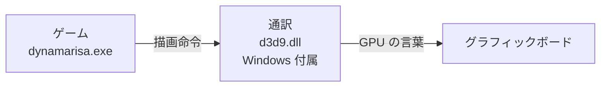

# ダイナマリサ3D HD MOD のしくみ

このドキュメントは、プログラミングの経験がない人にも「この MOD が何をしているのか」が伝わるように書いた解説です。専門用語にはできるだけたとえ話を添え、巻末に用語集をつけています。

---

## もくじ

1. [そもそもこの MOD は何をしているのか](#1-そもそもこの-mod-は何をしているのか)
2. [ゲームと画面のあいだに「通訳」を割り込ませる](#2-ゲームと画面のあいだに通訳を割り込ませる)
3. [高解像度化 ― 小さなキャンバスを大きなキャンバスにすり替える](#3-高解像度化--小さなキャンバスを大きなキャンバスにすり替える)
4. [遠景のぼかしを消す ― グラフィックボード用の小さなプログラムの数字を書き換える](#4-遠景のぼかしを消す--グラフィックボード用の小さなプログラムの数字を書き換える)
5. [ウィンドウ・全画面・マウスの範囲 ― Windows との会話を横で手直しする](#5-ウィンドウ全画面マウスの範囲--windows-との会話を横で手直しする)
6. [照準のブレーキを外す ― ゲーム本体の機械語を読んで書き換える](#6-照準のブレーキを外す--ゲーム本体の機械語を読んで書き換える)
7. [照準を細かくする ― 1カウントあたりの回転量を変える](#7-照準を細かくする--1カウントあたりの回転量を変える)
8. [60fps の壁とフレーム補間 ― パラパラ漫画の「中割り」を自動で描く](#8-60fps-の壁とフレーム補間--パラパラ漫画の中割りを自動で描く)
9. [どうやって調べたのか](#9-どうやって調べたのか)
10. [用語集](#10-用語集)

---

## 1. そもそもこの MOD は何をしているのか

ダイナマリサ3D は 2011 年のゲームで、画面を **1280×720 ピクセル(720p)** で描くように作られています。フルHD(1920×1080)や WQHD(2560×1440)のモニターで全画面にすると、720p の絵を引き伸ばして表示するので、ぼやけて見えます。

この MOD は、次のことを行います。

| 項目 | 元のゲーム | MOD 適用後 |
| --- | --- | --- |
| 描画解像度 | 1280×720 固定 | モニターの解像度(4K まで) |
| 遠景 | ぼかしがかかる | くっきり(選択式) |
| 照準 | 後半にブレーキがかかる、1カウントで大きく跳ねる | 入力どおりに即反映、細かく動く(選択式) |
| フレームレート | 中身は 60fps | 補間で 60fps 超(選択式・実験的) |
| ウィンドウ・全画面 | 720p 固定の窓、全画面で上端が欠ける | 好きな大きさ、全画面のズレ補正 |

大事な点として、**ゲーム本体(dynamarisa.exe)やゲームデータ(dynamarisa00.dat など)のファイルは一切書き換えていません**。MOD は `d3d9.dll` という1つのファイルで、ゲームフォルダから取り除けば完全に元に戻ります。

---

## 2. ゲームと画面のあいだに「通訳」を割り込ませる

### ゲームは自分で絵を描いていない

ゲームは画面の絵を自分で1ピクセルずつ塗っているわけではありません。「この形を、この色で、この位置に描いて」という**命令**を、グラフィックボード(GPU)に送っています。

ただ、GPU はメーカーや機種ごとに言葉が違います。そこで Windows には **DirectX** という「共通語の通訳」が用意されています。このゲームが使っているのは **DirectX 9** という世代で、その通訳の本体が `d3d9.dll` というファイルです。

### 通訳を「すり替える」

Windows のプログラムは、`d3d9.dll` のような部品を探すとき、**まず自分と同じフォルダを探し**、なければ Windows のシステムフォルダを探します。

この MOD はこの順番を利用して、ゲームフォルダに **同じ名前の `d3d9.dll`(MOD 版)** を置きます。するとゲームは MOD 版を本物だと思って読み込みます。MOD 版は受け取った命令を、必要なら少し書き換えてから、本物の `d3d9.dll` に渡します。

たとえるなら、ゲームと通訳の間に「添削係」を座らせたようなものです。ゲームは添削係の存在に気づかず、いつもどおり命令を出します。この手法は「DLL プロキシ」や「ラッパー」と呼ばれ、古いゲームの MOD でよく使われます。

### すべての命令を中継する

DirectX 9 には、描画の命令(関数)が100種類以上あります。MOD 版は、これらすべてを受け取って本物に渡す必要があります。全部を手で書くのは大変なので、Windows の開発キットに含まれる命令の一覧(`d3d9.h`)から、「受け取ってそのまま渡す」部分のプログラムを自動生成しています(`tools/gen_wrappers.py`)。そのうえで、手直しが必要な命令だけを個別に書き換えています(`src/main.cpp`)。

---

## 3. 高解像度化 ― 小さなキャンバスを大きなキャンバスにすり替える

### ゲームは「1280×720 のキャンバス」に描いている

このゲームの描画は、いきなり画面に描くのではなく、何枚もの**下書き用のキャンバス**(専門用語では「レンダーターゲット」)を使っています。

- 3D の景色を描くキャンバス(1280×720)
- 奥行きを記録するキャンバス(1280×720)
- 光のにじみ(ブルーム)を作るための小さなキャンバス(256×256 など)
- 影を作るためのキャンバス(1024×1024)
- 最後に完成させる、画面そのもの(1280×720)

最後に、これらを重ね合わせて画面に表示します。

### キャンバスを大きなものにすり替える

ゲームが「1280×720 のキャンバスを用意して」と頼んできたとき、MOD は**黙って 2560×1440(または 1920×1080 など)のキャンバス**を用意して渡します。影用のキャンバスも 1024 → 2048 に大きくしています。

しかし、それだけでは絵はおかしくなります。ゲームは「1280×720 のつもり」で座標を指定してくるからです。たとえば「(640, 360) にメニューを描いて」は、1280×720 なら画面の真ん中ですが、2560×1440 のキャンバスでは左上 1/4 の位置になってしまいます。

そこで MOD は、ゲームが出してくる座標を、キャンバスを広げた倍率に合わせて掛け算して直します。

- 2D の絵(メニュー、HUD、文字)の頂点座標
- 描画範囲(ビューポート)や、塗りつぶしの範囲

3D の物体は「画面の何割の位置」という比率で描かれるので、キャンバスが大きくなっても自動的に正しい位置に、より細かく描かれます。

### 「大きさを聞かれたら、元の大きさで答える」

開発中にぶつかった問題として、**一枚絵やゲーム画面が拡大されて一部しか映らない**というものがありました。

原因は、ゲームが「このキャンバス、大きさいくつ?」とあとから問い合わせていたことです。MOD がすり替えた大きなキャンバスが正直に「2560×1440 です」と答えてしまい、ゲームがそのサイズを前提に絵を2倍に拡大していました。

そこで、**MOD が大きくしたキャンバスについては、問い合わせに元の大きさ(1280×720)で答える**ようにしました。ゲームから見ると、すべてが今までどおり 1280×720 の世界のままです。

> **ゲームは何も知らない**というのがこの MOD の基本方針です。ゲームには「いつもの 1280×720」が見え続け、実際の描画だけが裏で高解像度になっています。だからゲーム本体を改造せずに済んでいます。

### 縮小表示もきれいに

内部で 2560×1440 に描いた絵を 1920×1080 のウィンドウに表示する場合、Windows に任せると、ピクセルを間引くだけの粗い縮小になり、ギザギザします。MOD は GPU で滑らかに縮小してから表示します。結果として、ふちのギザギザが減る効果(アンチエイリアス)も得られます。

---

## 4. 遠景のぼかしを消す ― グラフィックボード用の小さなプログラムの数字を書き換える

### シェーダーとは

GPU は、絵の各ピクセルの色を計算するための**小さなプログラム**を実行できます。これを「シェーダー」と呼びます。ゲームはたくさんのシェーダーを GPU に渡し、光の当たり方、影、にじみなどを計算させています。

### 遠景がぼやけていた理由

MOD はゲームが GPU に渡すシェーダーを横取りして、中身を人間が読める形(アセンブリ)に変換し、ファイルに書き出しました。調べた結果、**最後に画面を仕上げるシェーダー**が次のことをしていると分かりました。

1. 奥行きのキャンバスから、そのピクセルがどれくらい遠いかを読む
2. 遠いほど大きな半径で、周りの6点の色を平均する(=ぼかす)

これは「被写界深度」というカメラのピンぼけを再現する演出です。さらに、ぼかしの半径は「遠さ × 3 + 0.5」で計算されていて、**手前の物にも常に 0.5 ピクセル分のぼかし**がかかっていました。

### 数字を書き換える

このシェーダーの中には `3` と `0.5` という数字(定数)がそのまま埋め込まれていました。MOD は、ゲームがこのシェーダーを GPU に渡す瞬間に、この2つの数字に「強さ」を掛けてから渡します。

- オフ: 0 を掛ける → ぼかし半径 0 → くっきり
- 弱め: 0.5 を掛ける
- オリジナル: そのまま

どのシェーダーが目的のものかは、プログラムの中身から計算した**指紋のような値**(ハッシュ)で見分けています。

---

## 5. ウィンドウ・全画面・マウスの範囲 ― Windows との会話を横で手直しする

ゲームは画面の描画以外にも、Windows にいろいろなお願いをしています。「ウィンドウを作って」「この位置に動かして」「マウスはいまどこ?」などです。

### Windows への問い合わせの「電話帳」を書き換える

プログラムの中には、Windows の機能を呼び出すための**電話帳**のような表(インポートアドレステーブル、IAT)があります。「ウィンドウを動かしたいときはこの番号へ」という一覧です。

MOD はゲームの起動直後に、この電話帳のいくつかの番号を **MOD の番号** に書き換えます。するとゲームが Windows に電話したつもりでも、まず MOD に繋がります。MOD は内容を確認・手直ししてから、本物の Windows に繋ぎ直します。

この仕組みで、次の3つを直しています。

- **ウィンドウの大きさ**: ゲームが 1280×720 のウィンドウを作ったあと、MOD が設定どおりの大きさに広げます。
- **全画面化のズレ**: 元のゲームは Alt+Enter で全画面にするとき、ウィンドウを 左に3・上に26 ピクセルずれた位置に置いてしまい、画面の上端が欠けていました。MOD がモニターにぴったり合わせ直します。
- **マウスの反応範囲**: ゲームはマウスのウィンドウ内での位置を「1280×720 の座標」としてそのまま使い、マウスを閉じ込める範囲も 1280×720 の固定値で計算していました。そのため大きなウィンドウでは左上しか反応しませんでした。MOD がウィンドウの実際の大きさと 1280×720 の間で座標を変換して渡します。

---

## 6. 照準のブレーキを外す ― ゲーム本体の機械語を読んで書き換える

### ブレーキの正体

元のゲームでは、マウスを素早く動かすと、照準が途中までは追従したあと、残りをゆっくり追いかけてきました。

ゲーム本体のプログラム(`dynamarisa.exe`)は、CPU が直接実行する**機械語**でできています。MOD の開発では、これを人間が読める形(アセンブリ)に変換して、カメラを動かす部分を探しました。すると、次のような仕組みが見つかりました。

1. マウスを動かした量を、いったん「まだカメラに反映していない回転量」として貯める。
2. 毎フレーム、そのうち「0.5度 + 残りの一定割合」だけをカメラに反映し、残りは次のフレームに持ち越す。

残りが多いうちは大きく動くので速く追従しますが、残りが少なくなると1フレームの移動量も小さくなり、最後はじわじわ追いつきます。これが「後半のブレーキ」の正体でした。マウスもコントローラーも、同じ処理を通っていました。

### 機械語の「分かれ道」を付け替える

この処理には、「残りが 0.5度 以下なら、全部を一度に反映する」という分かれ道がありました。MOD は、この分かれ道の手前に「**いつでも全部反映する道へ進め**」という命令(ジャンプ命令)を上書きします。左右と上下の2か所です。

書き換えはファイルではなく、ゲーム起動時の**メモリ上**で行います。書き換える前には、そこにあるはずの命令が本当にあるかを照合し、違えば何もしません(別のバージョンの exe で誤動作しないための安全装置です)。

### 公式パッチで場所が変わった

公開後、公式パッチ v1.02 を当てると照準のブレーキが戻ってしまう、と分かりました。v1.02 ではカメラ処理が少し書き直されていて、書き換える場所の位置も命令の形も変わっていました。照合で「違う」と判断されて、安全装置が働いていたわけです。

そこで MOD に「初版ならここをこう書き換える」「v1.02 ならここをこう書き換える」という表を持たせました。起動時に、どちらの命令の並びと一致するかを調べて、一致した方の書き換えを行います。どちらとも一致しない未知のバージョンなら、これまでどおり何もしません。

### 開発中の落とし穴: 住所が毎回変わる

最初の版では、このパッチが実は一度も当たっていませんでした。この exe は、Windows のセキュリティ機能(ASLR)によって、**起動のたびにメモリ上の住所が変わる**設定になっていたためです。決め打ちの住所で書き換えようとしていたので、照合に失敗して何もしていませんでした。現在は、実際に読み込まれた住所を基準に計算しています。

---

## 7. 照準を細かくする ― 1カウントあたりの回転量を変える

マウスは動くと「何カウント動いたか」を報告します。このゲームの照準は、カーソルの位置ではなく、このカウント数に係数を掛けて回転させています。

ゲームの計算式は「1カウントあたりの回転量 = 0.087 × 1.75 × 感度係数」で、初期設定だと**約0.23度**でした。最近のゲームでは 0.02〜0.05 度程度が多いので、とても粗い値です。マウスをほんの少し動かしただけで、照準がカクッと跳ねていました。

`0.087` という係数は、ミッション開始時にゲームのスクリプト(後述)が設定します。MOD は毎フレームこの値を見張り、設定し直されるたびに 1/2〜1/4 を掛けて書き換えます。回転量が細かくなる分、同じ距離では回る量も減るので、マウスの DPI(感度)を上げて速さを合わせる、という使い方になります。

---

## 8. 60fps の壁とフレーム補間 ― パラパラ漫画の「中割り」を自動で描く

### 描き直してはいるが、中身が変わっていない

計測すると、このゲームは 200Hz のモニターで**1秒に200回**画面を描き直していました。ところが**画面の中身が変わるのは1秒に60回**だけでした。

このゲームは、

- キャラや弾を動かす係(ゲームロジック)
- 絵を描く係

が別々に動いています。ロジック係は **16ミリ秒ごと(1秒に約60回)** に1歩ずつ進み、描く係はその最新の状態を、何度も描き直しているだけでした。パラパラ漫画で、同じページを何度も見せている状態です。

ロジック係の歩幅を半分(8ミリ秒)にしてみると、ゲーム全体が2倍速になりました。ゲームのあらゆる動きが「1歩 = 1/60秒」の前提で作られているので、単純に速くすることはできません。

### 中割りを描く

アニメーション制作では、2枚の絵の間の絵を「中割り」と呼びます。フレーム補間は、この中割りを自動で作る試みです。

ゲームは物を描くたびに、「この物体はこの位置・この向きで描いて」という**数字の表(行列)**を GPU に渡しています。カメラの向き、キャラの位置、キャラの骨(関節)の曲がり具合などです。MOD はこの数字を物ごとに記録しておき、

- ロジック係が1歩進んで数字が変わったら、「直前の数字」と「最新の数字」を両方覚える
- 描くたびに、経過時間に応じて、2つの数字の間の値(例えば 30% 進んだ位置)を GPU に渡す

ことで、60回の更新の間を埋める絵を描いています。代わりに、表示はロジック1歩分(約16ミリ秒)遅れます。

### 一番の難所: 「どれが同じ物か」が分からない

MOD に見えているのは、「何かを、この数字で描け」という命令の列だけです。「これは妖精Aの左腕」といった情報はありません。そのため、前のフレームと今のフレームで「同じ物」を推測して対応付ける必要があり、ここで何度も失敗しました。開発中に実際に起きた問題と対策は、次のとおりです。

| 起きたこと | 原因 | 対策 |
| --- | --- | --- |
| 補間しても見た目が変わらない | ロジックの1歩分の更新が、描画の途中で2回に分かれて届いていた(物体が先、カメラが後など)。2回目を新しい1歩と誤解していた | 画面全体ではなく、物ごとに「数字が変わった時刻」を起点にする |
| 物がフレームごとに行き来してちらつく | 同じ形の物(弾など)は、描く順番が毎回入れ替わる。順番で対応付けると、弾Aと弾Bの間を補間してしまう | 動きの連続性や個数の変化で入れ替わりを見分け、その物だけ補間をやめる |
| フリーズ・クラッシュ | 「値が一番近い物」を総当たりで探す方式にしたら、物が多い場面で計算量が爆発した | 総当たりをやめ、軽い判定に戻す |
| キャラの体がバラけて貫通する | 骨ごと・パーツごとに「補間する/しない」がバラバラに決まっていた | 補間するかは描画単位でまとめて決め、ずれ方を揃える |

それでも推測で対応付けている以上、まれに一瞬乱れることがあるため、この機能は「実験的」としています。

### フレームレート上限

「1秒に何回描くか」の上限も選べます。上限を決めた場合は、高精度のタイマーで描画の間隔を均等に揃えています。

---

## 9. どうやって調べたのか

この MOD は、ゲームのソースコード(設計図)なしで作られています。そのため、外から観察して仕組みを推理する作業(リバースエンジニアリング)が大半でした。使った方法を紹介します。

### 描画命令を記録する

最初に、命令を素通しするだけの調査用 `d3d9.dll`(`src/probe.cpp`)を作りました。ゲームが GPU に出す命令を、すべてログに記録するものです。これで、どんな大きさのキャンバスを使っているか、2D をどう描いているかなどが分かりました。

### 画面を連続で保存して比べる

フレーム補間の調査では、ゲーム中に F12 キーを押すと直後の24フレームを縮小して保存する機能を MOD に入れました。保存した画像を1枚ずつ引き算して、「どのフレームで絵が変わったか」を数値で確かめました。

### 機械語を読む

Visual Studio 付属の `dumpbin` というツールで、`dynamarisa.exe` の機械語を人間が読める形に変換し(約2,100万文字)、手がかりになる文字列や数値を検索して処理を追いました。照準のブレーキ、マウスの範囲、フレームレートの仕組みは、この方法で見つけました。

### ゲームのスクリプトを読む

ゲームのデータファイル(`dynamarisa00.dat`)は暗号化されたアーカイブ(複数のファイルをまとめたもの)です。黄昏フロンティアの同時期の作品と同じ形式だと見当をつけて、暗号の解き方を突き止めました(`tools/research/datx.py`)。中には、ゲームの流れを書いた **Squirrel** という言語のスクリプトが、機械向けの形で入っていました。これを人間が読める形にするツールも作りました(`tools/research/sqdis.py`)。照準の係数 `0.087` は、ここから見つけたものです。

---

## 10. 用語集

| 用語 | 意味 |
| --- | --- |
| **MOD** | ゲームに後から機能を追加・変更する改造データ。 |
| **DLL** | 複数のプログラムで共有する部品ファイル。`d3d9.dll` もその一つ。 |
| **DirectX / Direct3D 9** | Windows で GPU に絵を描かせるための共通の仕組み。このゲームは2000年代の DirectX 9 を使う。 |
| **GPU / グラフィックボード** | 絵を描く計算が得意な部品。 |
| **プロキシ / ラッパー** | 本物との間に入って、命令を中継・手直しする仕組み。 |
| **解像度** | 画面を構成する点(ピクセル)の数。1280×720 は 720p、1920×1080 はフルHD。 |
| **レンダーターゲット** | 描画用の下書きキャンバス。 |
| **シェーダー** | GPU 上で動く小さなプログラム。光や色の計算をする。 |
| **被写界深度** | ピントの合っていない遠景をぼかす表現。 |
| **アンチエイリアス** | ふちのギザギザを目立たなくする処理。 |
| **IAT(インポートアドレステーブル)** | プログラムが Windows の機能を呼び出すための番号の一覧。電話帳のようなもの。 |
| **機械語 / アセンブリ** | CPU が直接実行する命令。アセンブリはそれを人間が読める文字にしたもの。 |
| **ASLR** | 攻撃対策のため、プログラムが置かれるメモリ上の住所を毎回変える Windows の機能。 |
| **ハッシュ** | データの中身から計算した、指紋のような短い値。同じ中身なら同じ値になる。 |
| **行列** | 物体の位置・向き・大きさを表す数字の表。 |
| **フレーム / fps** | 画面1枚分の絵と、それを1秒に何枚表示するか。 |
| **補間** | 2つの値の間の値を計算すること。 |
| **Squirrel** | このゲームのスクリプト(ゲームの流れの記述)に使われているプログラミング言語。 |
| **リバースエンジニアリング** | 完成品を観察・分析して、仕組みを解き明かすこと。 |
